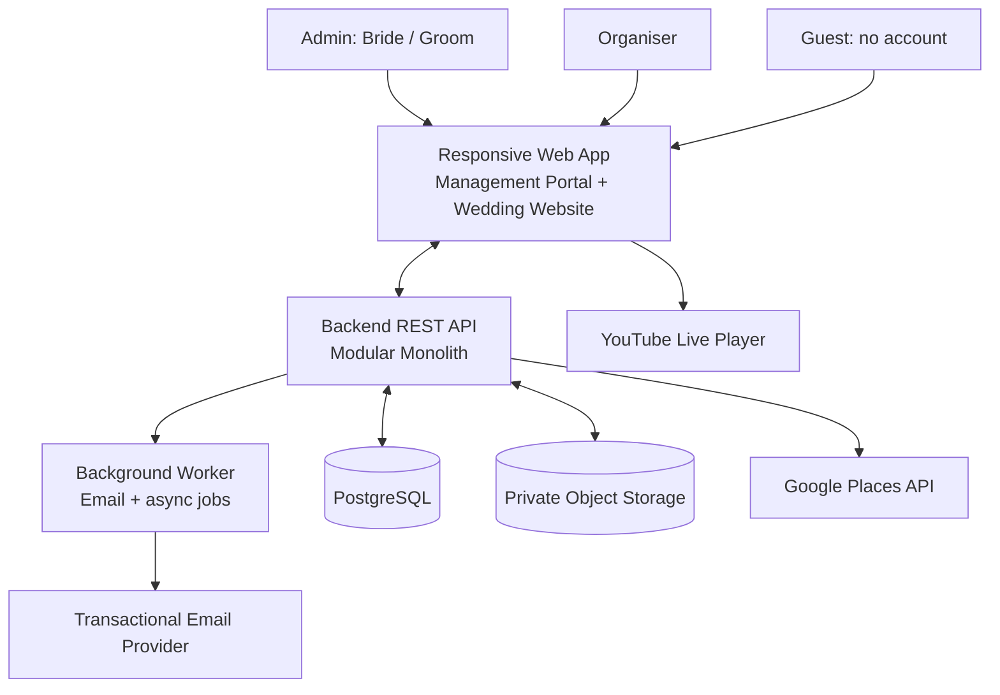
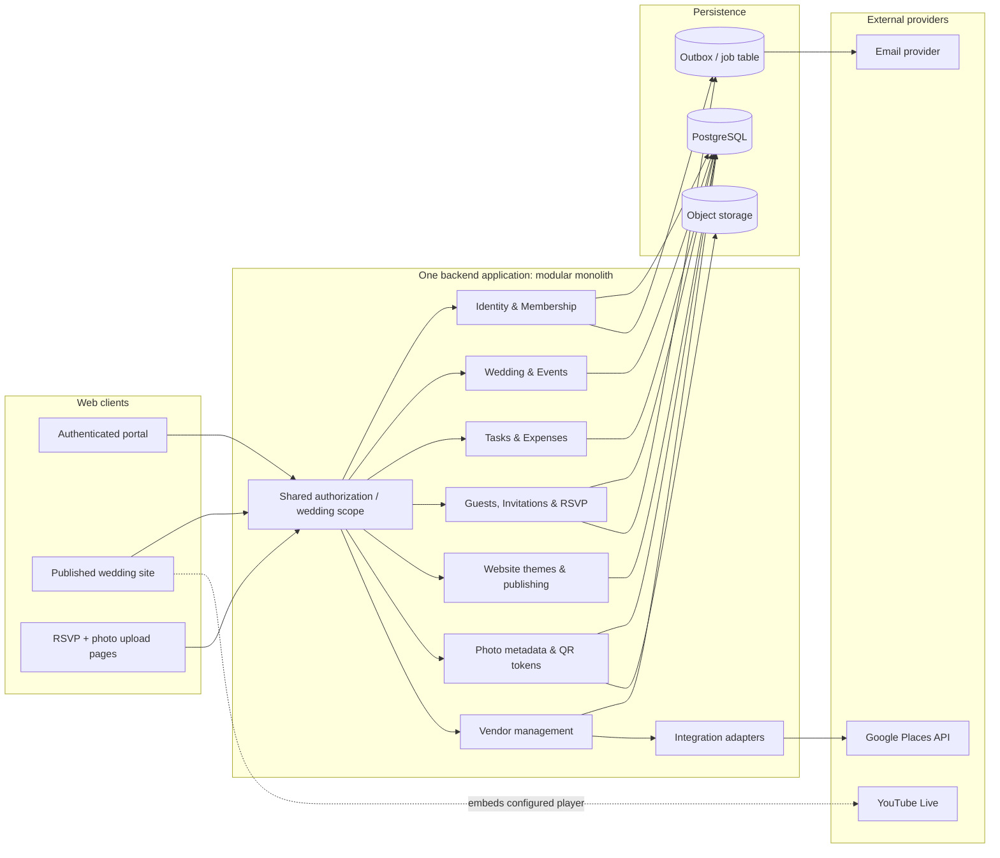
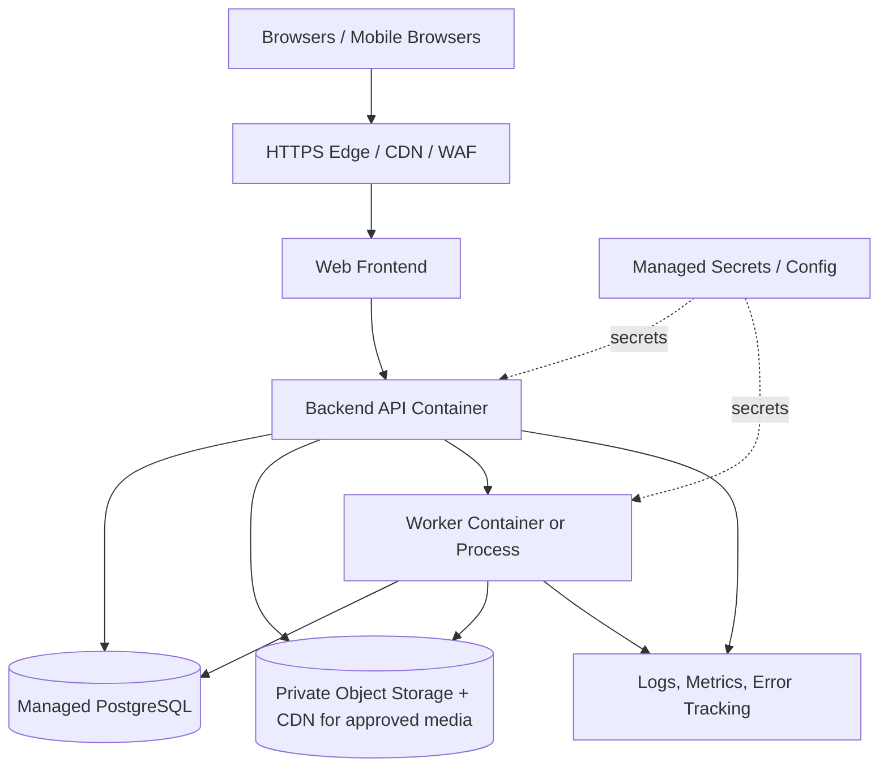

# Make My Marriage — V1 System Architecture

**Document status:** Proposed baseline for technical review  
**Product:** Make My Marriage  
**Scope:** V1 web application  
**Relationship to PRD:** Architecture for the agreed V1 feature set; it does not expand product scope.

---

## 1. Architecture summary

Build V1 as a **responsive web application backed by a modular monolith API**, with one relational database, cloud object storage for media, a background worker for outbound email and asynchronous processing, and adapters for external services.

This approach provides clear module boundaries without the operational overhead of microservices. It can support the V1 journey—create a wedding, manage events and people, send invitations, receive RSVPs, publish a themed website, embed YouTube Live, share photos, and discover vendors—while remaining practical for a small team.

### Proposed implementation stack (not yet a user-approved constraint)

| Layer | Proposed baseline | Why |
|---|---|---|
| Web frontend | Next.js + React + TypeScript | Responsive authenticated portal and public wedding websites in one frontend codebase. |
| Backend | Java + Spring Boot REST API | Clear domain modules, validation, authorization, and integrations. |
| Database | PostgreSQL | Relational records and strong constraints for wedding-scoped data. |
| File storage | S3-compatible private object storage | Photos and wedding media should not be stored as database blobs. |
| Background work | Worker process with durable job/outbox table; managed queue can be added | Reliable invitation/reminder delivery and media processing without blocking user requests. |
| Email | Transactional email provider | Invitation, organiser invitation, and manually triggered RSVP reminder emails. |
| Vendor discovery | Google Places API (New) | Nearby place search, place details, ratings and rating counts where returned. |
| Livestream | YouTube Live embedded player | V1 stores the stream identifier/URL and embeds the player; it does not host video. |
| Hosting | Managed cloud hosting with HTTPS, managed PostgreSQL, object storage, secrets management, logs and backups | Reduces infrastructure maintenance. |

The **logical architecture is the decision to keep modules in one backend application**. Specific vendors and hosting products can change without changing the domain model.

---

## 2. Architecture principles

1. **Wedding-scoped tenancy:** all management data belongs to a wedding. Server-side access checks must confirm that the signed-in user is a member of that wedding.
2. **Three product roles only:** `ADMIN`, `ORGANISER`, and guest-facing access without a user account. Do not introduce a separate finance manager or viewer role in V1.
3. **Admin/Organiser permissions:** both can perform wedding operations; only Admin can add or remove Organisers. The API must enforce this rule, not just the UI.
4. **Guests do not create accounts:** guest flows use narrowly scoped, non-guessable links/tokens for RSVP and photo upload.
5. **Modular monolith first:** domain modules have clear boundaries but are deployed as one backend application initially.
6. **Media is separate from transactional data:** store photo bytes in object storage and store metadata/references in PostgreSQL.
7. **External-service isolation:** Google Places, email, object storage and YouTube details sit behind integration components so they can be changed or tested independently.
8. **No hidden vendor scoring:** show source ratings transparently; do not generate a Make My Marriage “best vendor” score.
9. **Privacy by default:** guest routes must never expose expenses, collaborator membership, internal notes, guest emails, or unpublished website settings.
10. **Operational simplicity:** no microservices, complex event streaming, native mobile apps, or drag-and-drop website builder in V1.

---

## 3. High-level system context

### Trust boundaries

- Admin and Organiser use authenticated routes.
- Guests use public wedding-site routes and token-authorized RSVP/photo flows.
- Google Places and the email provider are external services; server-side credentials must never be shipped to the browser.
- YouTube serves the actual stream. Embedding it on a Make My Marriage page does not give Make My Marriage control over YouTube's viewer permissions.

---

## 4. Logical component architecture

### Module boundaries

| Backend module | Owns | Main dependencies |
|---|---|---|
| Identity & Membership | Users, login, password recovery, wedding membership, role checks | PostgreSQL, email adapter |
| Wedding & Events | Wedding profile, venue/location, event details | PostgreSQL, location/geocoding adapter if selected |
| Tasks | Tasks, status, priority, due date, assignee, optional vendor reference | Membership, Events, Vendors |
| Expenses | Expense records, categories, paid/unpaid, payer, payment date, optional vendor reference | Membership, Events, Vendors |
| Guests | Guest list, event membership, CSV/Excel import | Membership, Events |
| Invitations & RSVP | Invitation attempts, secure guest links, response state, manual RSVP reminders | Guests, Events, email adapter, token service |
| Website | Four fixed themes, content configuration, slug, preview/publish state | Wedding, Events, RSVP links, Livestream config |
| Livestream | Provider type, configured YouTube video/live ID, enabled state | Website; YouTube player runs client-side |
| Photos & QR | Upload sessions, photo metadata, moderation, share/upload tokens, QR destinations | Object storage, Events, token service |
| Vendors | User-entered vendor records, category, event associations, optional task/expense references | Membership, Events, Tasks, Expenses |
| Vendor Discovery Adapter | Place search, type mapping, distance/radius, provider response normalization | Google Places API, usage limits, attribution rules |
| Shared Authorization | Authenticated user checks, wedding scope, role-specific policies, guest-token policy | All modules |
| Background Worker | Email delivery, retry handling, upload/image post-processing if needed | Job/outbox table, email, object storage |

---

## 5. Recommended deployment shape

Deploy a small number of managed components rather than separate services for every module.

### Environments

- **Local development:** local frontend/API, development database, test email mode, provider sandbox or low-quota keys.
- **Staging:** separate database and object bucket, test wedding records, email delivery restricted to approved addresses, and production-like role/guest-link testing.
- **Production:** separate credentials, managed database backups, private object storage, domain/email authentication, monitoring, and spend/quota alerts.

Do not share production secrets or production guest data with local development.

---

## 6. Application and API design

### API style

- JSON REST API, versioned under `/api/v1`.
- Consistent validation and error response format.
- Pagination on list endpoints.
- Server-side input validation; never rely only on browser validation.
- Idempotency for email-send and photo-completion operations where duplicate requests could create side effects.
- No direct database access from the frontend.

### Example endpoint groups

These are proposed route shapes, not a frozen OpenAPI contract.

| Area | Example endpoints |
|---|---|
| Authentication | `POST /api/v1/auth/register`, `POST /api/v1/auth/login`, `POST /api/v1/auth/logout`, `POST /api/v1/auth/password-reset` |
| Wedding | `POST /api/v1/wedding`, `GET /api/v1/wedding`, `PATCH /api/v1/wedding` |
| Events | `GET /api/v1/events`, `POST /api/v1/events`, `GET /api/v1/events/{eventId}`, `PATCH /api/v1/events/{eventId}`, `DELETE /api/v1/events/{eventId}` |
| Membership | `GET /api/v1/members`, `POST /api/v1/members/organiser-invitations`, `DELETE /api/v1/members/{memberId}` |
| Tasks | `GET /api/v1/tasks`, `POST /api/v1/tasks`, `PATCH /api/v1/tasks/{taskId}`, `DELETE /api/v1/tasks/{taskId}` |
| Expenses | `GET /api/v1/expenses`, `POST /api/v1/expenses`, `PATCH /api/v1/expenses/{expenseId}`, `DELETE /api/v1/expenses/{expenseId}` |
| Guests | `GET /api/v1/guests`, `POST /api/v1/guests`, `POST /api/v1/guests/import`, `PATCH /api/v1/guests/{guestId}` |
| Invitations / RSVP | `POST /api/v1/invitations`, `POST /api/v1/rsvp-reminders`, `GET /guest/rsvp/{token}`, `POST /guest/rsvp/{token}` |
| Website | `GET /api/v1/website`, `PUT /api/v1/website`, `POST /api/v1/website/preview`, `POST /api/v1/website/publish`, `POST /api/v1/website/unpublish` |
| Livestream | `GET /api/v1/livestream`, `PUT /api/v1/livestream` |
| Photos | `POST /guest/photos/upload-session`, `POST /guest/photos/complete`, `GET /guest/gallery/{token}`, `DELETE /api/v1/photos/{photoId}` |
| Vendors | `GET /api/v1/vendors`, `POST /api/v1/vendors`, `PATCH /api/v1/vendors/{vendorId}`, `DELETE /api/v1/vendors/{vendorId}`, `GET /api/v1/vendor-discovery` |

Authenticated management endpoints should derive the wedding scope from the user's active membership on the server, rather than trust a client-supplied `weddingId` alone.

---

## 7. Identity, roles, and tenancy

### Suggested model

- `users`: a person with a login credential and profile.
- `weddings`: one central wedding workspace.
- `wedding_members`: associates a user with a wedding and assigns `ADMIN` or `ORGANISER`.
- Guests are stored separately and do not need `users` records.

### Important database constraints

- One user can belong to at most one wedding in V1: enforce a unique constraint on `wedding_members.user_id`.
- A wedding can have several members, including Admins and Organisers.
- A member must have exactly one role in that wedding.
- Only an Admin can invite/remove Organisers.
- An Organiser cannot add/remove members or change role assignments.
- All management-domain records include `wedding_id` directly or are reachable only through a parent with `wedding_id`.

### Admin onboarding note

The product treats the bride and groom as Admins, but the flow for giving the second Admin access must be implemented explicitly. The architecture supports multiple Admin memberships. The PRD still needs to confirm whether the creator invites the second Admin using an Admin invitation flow, or whether both Admins are added during setup. This is a workflow decision, not a reason to add a fourth role.

### Authorization sequence

1. Authenticate the user.
2. Load the user's wedding membership.
3. Confirm the requested record belongs to that wedding.
4. Check the role and operation.
5. Execute the command and write an audit event for sensitive changes where applicable.

The API must prevent insecure direct object reference (IDOR) issues by checking wedding ownership/scope even when a record ID is valid.

---

## 8. Data architecture

PostgreSQL is the source of truth for structured product data. Object storage holds photo files. Vendor-provider content is retrieved under the provider's rules; it is not automatically copied into a permanent local vendor record.

### Core entities

| Entity | Key fields and notes |
|---|---|
| `users` | `id`, normalized unique email, password hash/identity provider reference, display name, timestamps |
| `weddings` | `id`, creator user, bride/groom names, date, contact details, venue address, latitude/longitude, photo object key, timestamps |
| `wedding_members` | `id`, `wedding_id`, `user_id` (unique), role enum, invitation/active status, timestamps |
| `events` | `id`, `wedding_id`, name, date, start time, venue, address/coordinates, notes, optional photo object key |
| `tasks` | `id`, `wedding_id`, optional `event_id`, name, description, assignee member, due date, priority, status, notes, optional `vendor_id` |
| `expenses` | `id`, `wedding_id`, optional `event_id`, description, amount in INR paise or decimal-safe representation, category, paid status, payment date, payer text/member reference, optional `vendor_id`, notes |
| `guests` | `id`, `wedding_id`, name, email, invitation summary/status, timestamps |
| `event_guests` | `event_id`, `guest_id`, per-event RSVP response and response timestamp; unique `(event_id, guest_id)` |
| `invitation_attempts` | `id`, `wedding_id`, `guest_id`, optional `event_id`, template/version, provider message ID, delivery state, timestamps; do not store raw guest tokens in logs |
| `guest_tokens` | hash of opaque token, purpose, wedding/guest/event scope, expiration, revocation, last-used metadata |
| `website_configs` | `id`, `wedding_id` unique, theme code/version, content JSON, slug unique, published state, timestamps |
| `livestream_configs` | `id`, `wedding_id` unique, provider, YouTube video/live identifier, enabled state, viewer-facing guidance |
| `photos` | `id`, `wedding_id`, optional `event_id`, object key, content type, size, uploader/session reference, moderation state, timestamps |
| `photo_upload_sessions` | token hash, wedding scope, expiry, upload limits, status; used for unauthenticated guest uploads |
| `vendors` | `id`, `wedding_id`, category, user-entered name/contact/notes, optional provider and `place_id`, timestamps |
| `vendor_events` | association between a saved vendor and event; unique `(vendor_id, event_id)` |
| `background_jobs` / `outbox` | event/email type, payload reference, status, attempts, next retry time, timestamps |
| `audit_events` | actor, wedding, action, target type/ID, timestamp, minimal metadata for membership/content-sensitive changes |

### Relationship rules

- Wedding → many events, guests, members, expenses, vendors, tasks, photos.
- Event ↔ Guest is many-to-many through `event_guests`; RSVP is event-specific.
- Vendor ↔ Event is many-to-many through `vendor_events`.
- Task optionally references a vendor.
- Expense optionally references a vendor.
- One wedding → one published website configuration in V1, with one selected theme at a time.
- Guest uploads and RSVP responses are linked to the wedding and validated guest/token scope.

### Data isolation

Every read/write query for management data must be constrained by the authenticated member's wedding. Consider PostgreSQL row-level security only if the team has the expertise to maintain it; application-level scope checks plus comprehensive integration tests are a minimum requirement.

---

## 9. Detailed integration architecture

### 9.1 Email

Use a `EmailService` adapter so the application is not coupled to one provider.

**Flow:** user triggers send → API validates permission and recipients → invitation/reminder job is committed to the job/outbox table → worker sends email → provider message ID and delivery result are recorded.

- RSVP reminders are user-triggered for pending guests; they are not automated schedules.
- Task reminder emails are out of scope.
- Use verified sender domains and configure SPF, DKIM, and DMARC.
- Handle transient errors with bounded retries; avoid duplicate sends with idempotency keys.
- Track accepted, bounced, rejected, and provider-reported delivery states where supported. An accepted send is not the same as a message being read.

### 9.2 Google Places — nearby vendor discovery

**Flow:** Admin/Organiser selects vendor category and radius → backend resolves the wedding/event venue coordinates or selected alternative location → Places adapter requests only needed fields → API normalizes the response → frontend shows a list/map with Google attribution → user selects a result → app saves a wedding vendor record.

- Keep the Google API key on the server for web-service calls; restrict credentials and apply quotas/budget alerts.
- Use explicit field masks, e.g. place ID, display name, formatted address, rating, user-rating count, phone and website only when required and available.
- Treat source ratings as third-party data, not as a Make My Marriage ranking.
- Persist the Google `place_id` and user-entered wedding-specific details. Do not persist/cache other Google Places content indefinitely unless permitted by the applicable current terms. Google says place IDs are exempt from its general caching restrictions; displayed Places content has attribution and usage requirements. See official policy links in References.
- A saved vendor remains a wedding record even if current discovery data is temporarily unavailable; vendor discovery should fail gracefully.
- Vendor categories such as “Backdrop Decorator” may not map cleanly to a Google place type. Use a controlled mapping to supported types and/or a text-search fallback, without promising every specialist will be indexed.

### 9.3 YouTube Live

- Store the video/live ID or canonical URL, enabled state, and any user-facing privacy guidance.
- Render the YouTube player through the supported embed/iframe approach; do not proxy the video through the backend.
- Never request or store the user's YouTube stream key.
- Test playback on mobile and desktop, with autoplay disabled by default unless user interaction starts playback.
- Show an error/fallback state if the stream is not live, unavailable, blocked from embedding, or removed.

**Privacy limit:** embedding is not an access-control boundary. YouTube lets creators configure public, unlisted, or private streams, but the stream's actual access is governed by YouTube. Unlisted links can be forwarded; private streams have YouTube account/viewer constraints. Do not market an unlisted embedded stream as fully private. Product copy and onboarding need to make this clear. [YouTube live stream settings](https://support.google.com/youtube/answer/9854503) · [YouTube IFrame Player API](https://developers.google.com/youtube/iframe_api_reference).

### 9.4 Photo uploads and gallery

**Flow:** guest opens a wedding-scoped upload link/QR → server validates purpose, wedding scope, expiration and rate limits → server returns a short-lived signed object upload URL → browser uploads directly to object storage → browser calls completion endpoint → backend checks object key, file size/type and session state → photo enters moderation state → approved photo can be displayed in gallery.

- Do not route large image bytes through the API server.
- Use private buckets by default; issue short-lived signed read URLs or a controlled image-delivery route for approved photos.
- Validate actual file type, size, file signature and image dimensions; do not trust the filename or browser MIME alone.
- Apply per-file and per-wedding storage limits, upload throttling, and abuse protection.
- Default new public guest uploads to `PENDING_REVIEW` until a product owner explicitly chooses automatic publication.
- Admin/Organiser can hide/delete uploads. Record the moderation state and avoid exposing storage keys.

### 9.5 Website publishing and four themes

- Keep exactly four first-party theme implementations in the frontend codebase, each using the same validated content schema.
- Store selected theme code/version and the user's structured content in `website_configs`.
- Do not accept raw HTML/JavaScript from users and do not build a drag-and-drop editor in V1.
- Preview renders unpublished content for authorized Admins/Organisers only.
- Publish sets a website slug/state; public route renders only approved published fields.
- Unpublish immediately removes the guest-facing public view or shows an unavailable page.
- RSVP and livestream are optional sections that use the relevant guest token/configuration.

### 9.6 QR and guest tokens

QR codes should encode a URL, not privileged information. The route carries an opaque random token or a public website URL appropriate to the QR's purpose.

- Separate token purposes: RSVP, photo upload, and optional website access.
- Store a hash of bearer tokens where practicable, not the raw token.
- Tokens must be high entropy, wedding-scoped, rate-limited and revocable.
- Public `GET` requests should not mutate RSVP or data; the guest must submit an explicit RSVP `POST` action.
- Add protection against link guessing, automated upload abuse and repeated RSVP spam.

---

## 10. Security, privacy, and reliability

### Authentication and sessions

- Use a mature framework/library rather than custom cryptography.
- Hash passwords with a current password-hashing algorithm and safe parameters.
- Use HTTPS everywhere; secure, HttpOnly, SameSite cookies are the recommended browser session baseline if cookie-based auth is used.
- Protect state-changing requests against CSRF where cookies are used.
- Rate-limit login, password recovery, invitation, RSVP, upload and vendor-search endpoints.
- Keep provider keys in a secrets manager/environment secret store; do not commit keys or expose server keys in browser bundles.

### Authorization

- Centralize policy checks for `ADMIN`, `ORGANISER`, and token-authorized guest actions.
- Verify membership and `wedding_id` scope on every management request.
- Guest endpoints must expose only the minimum fields needed for their action.
- Never expose expense values, guest email lists, collaborator records or private notes through guest/public website payloads.

### Data and media safety

- Encrypt transport with TLS and rely on managed encryption at rest for database/object storage.
- Back up PostgreSQL and periodically test restore procedures.
- Keep photo buckets private and use controlled signed access.
- Define retention and deletion behavior before public launch.
- Use audit events for organiser membership changes, website publish/unpublish, livestream setting changes and photo deletion/moderation.

### Reliability and observability

- Health/readiness endpoints for frontend, API and worker.
- Structured logs with request IDs; redact passwords, raw tokens, signed URLs, and sensitive guest details.
- Metrics/alerts for API errors, email failures, queue age, storage usage, Google API errors/quota, and database connections.
- Retry only transient failures with backoff; send repeatedly failing jobs to a dead-letter/failed state for inspection.
- Make dashboard data resilient: failure of Google Places or YouTube should not take down tasks, events, expenses or guest management.

---

## 11. Performance and scaling

V1 should be designed for low operational overhead and occasional wedding-day spikes.

- Paginate guest, task, expense, vendor and photo lists.
- Use database indexes for `wedding_id`, event date, task status/due date, guest email, RSVP state, vendor category, and join-table keys.
- Store photos externally and deliver approved images via signed URLs/CDN where appropriate.
- Use asynchronous email processing so batch invitations do not hold up HTTP requests.
- Limit CSV/Excel upload size and number of rows per import; validate in a worker if imports grow large.
- Add Redis only if measured needs arise (e.g. shared rate-limits, short-lived cache, or job coordination). It is not mandatory for the first release.
- Start with one API deployment and one worker deployment. Scale them independently only when measurements justify it.

---

## 12. Testing strategy

| Test layer | Key coverage |
|---|---|
| Unit tests | Task status rules, guest RSVP state transitions, token validation, theme schema validation, vendor type mapping, expense validation. |
| API/integration tests | Wedding-scope isolation, Admin vs Organiser permissions, one-wedding-per-user constraint, CSV imports, invitation/job creation, vendor/expense/task references. |
| Guest-flow tests | RSVP with valid/expired/revoked token, no login requirement, photo upload limits, gallery moderation, public website content only. |
| Provider contract tests | Google Places field mapping, email provider response/error mapping, YouTube URL/ID validation; mock external services in automated tests. |
| End-to-end tests | Create wedding → add event → add guests → send invitation → RSVP → view dashboard; website theme publish; save vendor and link to event/task/expense; photo QR upload and moderation. |
| Security tests | IDOR attempts across weddings, token guessing/replay, rate limits, file upload abuse, secret leakage, CSRF/session controls where applicable. |
| Operational tests | Restore database backup, retry failed email job, Google quota/no-result fallback, object storage unavailability. |

---

## 13. Suggested implementation order from an architecture perspective

1. **Foundation:** repository, environment configuration, authentication, database migrations, logging, error format, and shared authorization.
2. **Wedding core:** wedding creation, membership rules, wedding profile and events.
3. **Planning:** tasks, expenses, dashboard queries.
4. **Guests:** guest CRUD, CSV/Excel import, event associations, invitation queue, tokenized RSVP, manual RSVP reminder flow.
5. **Website:** common content schema, four themes, preview/publish routes.
6. **Vendors:** saved vendor CRUD, vendor-event join, task/expense references, Places API adapter and quota controls.
7. **Media and livestream:** photo upload sessions, object storage, moderation, QR codes, YouTube embed setup.
8. **Hardening:** permission/security tests, deliverability, analytics, accessibility, backup/restore, error monitoring and deployment runbooks.

This is a recommended order, not a change to the PRD's feature scope. It builds foundational dependencies first and postpones the highest-risk media and external integrations until access control and core data are stable.

---

## 14. Decisions to confirm before implementation

The architecture can proceed on this proposed basis, but these decisions need explicit confirmation before developers lock the implementation:

1. **Technology stack:** accept or replace Next.js/TypeScript + Java/Spring Boot + PostgreSQL.
2. **Second Admin onboarding:** invite the second Admin during wedding setup, or let an existing Admin issue an Admin invitation. Only Admin can manage Organisers either way.
3. **Website visibility:** public wedding page or unlisted/link-access page; RSVP/photo/livestream should have their own controls.
4. **Livestream privacy:** choose between low-friction unlisted YouTube access and YouTube's private viewer model. Make My Marriage cannot enforce privacy beyond YouTube's own behavior while using the embedded player.
5. **Photo visibility:** auto-publish uploads or require Admin/Organiser approval. Recommended V1 default: approval required.
6. **Guest RSVP granularity:** maintain RSVP per event (recommended because each event has its own guest list) rather than a single wedding-wide response.
7. **Website URL strategy:** generated slug under the product domain; custom domains remain out of V1 unless explicitly added.
8. **Retention/deletion:** decide what happens to wedding data and photos after the event or if an account is deleted.
9. **Provider budgets:** choose email provider and establish Google Maps Platform budget/quota alerts before enabling vendor discovery publicly.

---

## 15. Official integration references

- Google Places Nearby Search (New): https://developers.google.com/maps/documentation/places/web-service/nearby-search
- Google Places data fields and field masks: https://developers.google.com/maps/documentation/places/web-service/data-fields
- Google Places policies and attribution: https://developers.google.com/maps/documentation/places/web-service/policies
- Google Place IDs and storage exception: https://developers.google.com/maps/documentation/places/web-service/place-id
- YouTube Live stream visibility settings: https://support.google.com/youtube/answer/9854503
- YouTube IFrame Player API: https://developers.google.com/youtube/iframe_api_reference

---

**Status:** Proposed V1 system architecture. Once the stack and the open product decisions above are confirmed, this document can be used to prepare the physical database schema, OpenAPI specification, deployment diagram, and development backlog.
